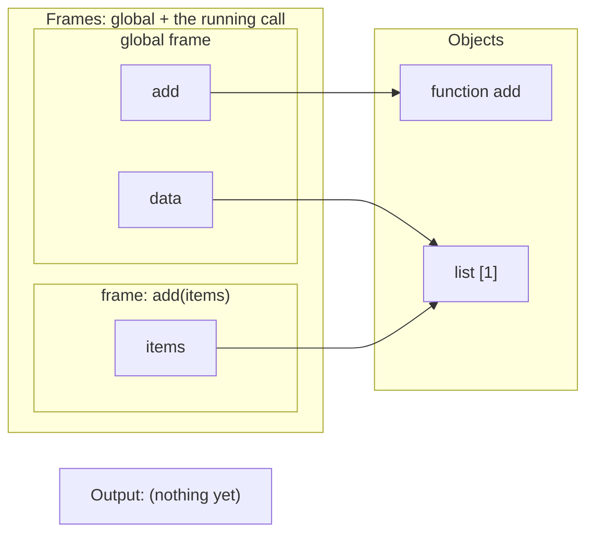
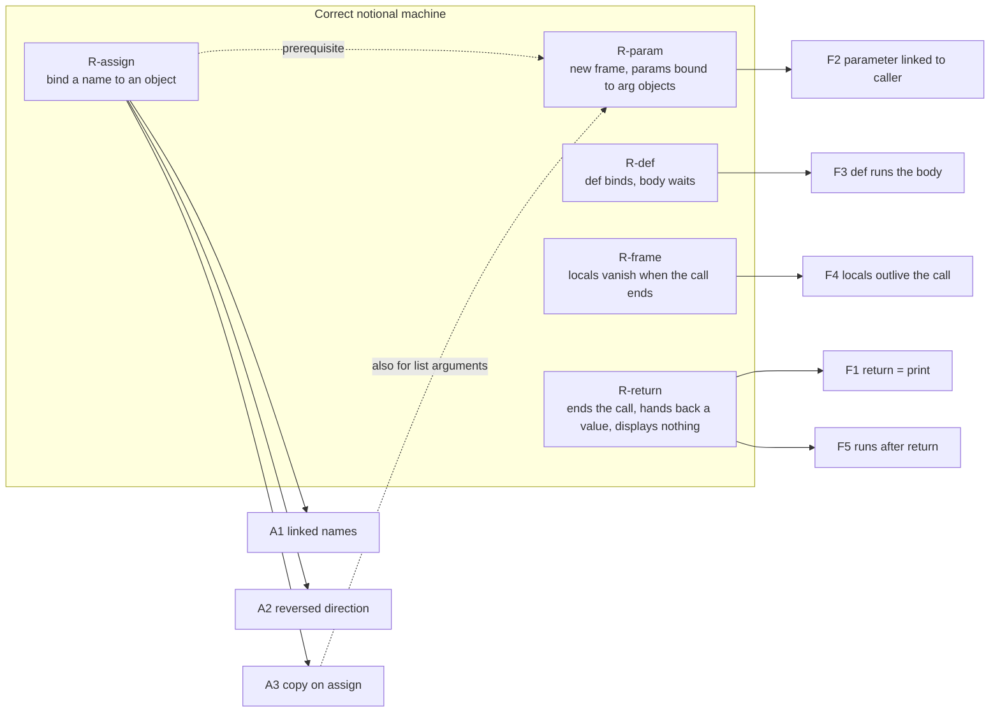
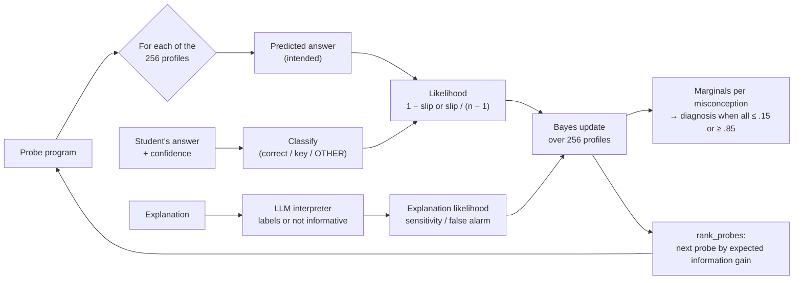

# The Notional Machine and the Misconception Model

Status: reference description of the system as built (code at commit `3a00ed7`). Owner: Suzanne Szabo.
Related: `mm_agent/catalog.py`, `mm_agent/probes.py`, `mm_agent/belief.py`,
`docs/mental-model-representation.md` (why this representation), `docs/catalog-sources.md` (evidence),
`docs/decisions.md`.

This document defines two things exactly:

1. **The notional machine**: the correct, simplified model of how Python runs the programs in scope.
   It is the target the lesson teaches.
2. **The misconception model**: how a student's possibly wrong version of that machine is represented,
   how it predicts the student's answers, and how the agent infers it from those answers.

Section 6 gives the diagrams. They are written in Mermaid, which renders on GitHub and in VS Code.

---

## 1. Scope

The machine covers **assignment** and **function calls** in Python: binding names, aliasing a list,
`def`, calling, parameters, local variables, `return` and `print`. Assignment is included as a
prerequisite tier because parameter passing in Python *is* assignment (D1).

**Out of scope:**
- loops;
- `global` and `nonlocal`;
- nested functions and closures;
- recursion (planned for the RISC-V call-stack lessons);
- default arguments;
- dictionaries and tuples;
- exceptions other than a name that does not exist.

The one conditional used (`if` in P13) is assumed to be understood.

---

## 2. The correct notional machine

### 2.1 State

At any moment the machine consists of five parts:

| Component | What it is |
|---|---|
| **Objects** | Values that exist independently of names: numbers, strings, lists, functions, `None`. A list object can be changed in place (mutated). |
| **Frames** | A frame is a table from names to objects. There is always a **global frame**. Each function call adds one **call frame**. |
| **Call stack** | The frames in order; the top frame is the one currently running. Name lookup uses the top frame first, then the global frame. |
| **Current line** | Which line of which frame runs next. |
| **Output** | The lines printed so far. Printing is the only way anything appears on screen. |

A name never holds a value directly. It **refers to** an object. Two names can refer to the same object.

### 2.2 The five rules

Every misconception in the catalog replaces exactly one of these rules (Section 3).

| Rule | The correct notional machine |
|---|---|
| **R-assign** | `x = expr` evaluates `expr` to an object, then binds the name `x` in the current frame to that object. Assignment never copies an object, and never links one *name* to another: rebinding `x` later has no effect on any other name. Mutating an object (`b.append(3)`) changes the object itself, so the change is visible through every name that refers to it. |
| **R-def** | `def f(...):` creates a function object and binds `f` to it. The body does not run. It runs only when `f` is called, each time it is called. |
| **R-param** | A call `f(arg)` evaluates `arg`, pushes a new frame, and binds each parameter in the new frame to the argument's *object* (assignment again, per R-assign). Rebinding the parameter changes only the new frame. Mutating the object through the parameter is visible to the caller. |
| **R-frame** | Names created inside a call exist only in that call's frame. When the call ends, the frame is removed and its names are gone. Using such a name afterwards is an error. Objects survive if another name still refers to them. |
| **R-return** | `return expr` evaluates `expr`, ends the call *immediately* (no later line in the function runs), removes the frame, and the call expression becomes that value. It displays nothing. A function that ends without `return` gives back `None`. `print(...)` displays its arguments and gives back `None`. |

**Error rule.** Looking up a name that is in neither the top frame nor the global frame is an error (a
`NameError`). In this project any answer mentioning an error is treated as the single answer `error`.

### 2.3 What "what does this print?" means

The student predicts the output of a short program. Answers are compared after normalization:
- printed lines are joined with ` | `;
- whitespace is collapsed;
- text is lower-cased;
- any mention of an error, exception or crash becomes `error`.

Hedges ("maybe", "I think", "?") are stripped first (D24).

### 2.4 Pass-by-assignment in one picture

R-assign and R-param together are Python's "pass by assignment". The parameter refers to the *same
object* as the caller's variable, so:

| Inside the function | Effect on the caller | Probe |
|---|---|---|
| Rebind the parameter: `n = n + 1` | None. Only the call frame's name changes | P07, P15 |
| Mutate the object: `items.append(1)` | Visible. It is the same object | P14 |

This distinction is the most important idea in the scope. Three of the eight misconceptions are
different ways of getting it wrong (A1, A3, F2).

---

## 3. The misconception model

### 3.1 A misconception is a replaced rule

A **misconception** is a known wrong version of one rule. Each is taken from research or teaching
materials (`docs/catalog-sources.md`). The catalog has eight, in two tiers. The catalog order matters
(Section 3.4).

| Id | Replaces | The student's (buggy) rule | Evidence |
|---|---|---|---|
| `A1_LINKED` | R-assign | `b = a` links the *names*: when `a` is later rebound, `b` is rebound to match, and vice versa. | Moderate |
| `A2_REVERSED` | R-assign | `x = y` moves the value left to right: `x`'s value is stored into `y`. | Strong |
| `A3_COPY_ON_ASSIGN` | R-assign (and R-param for lists) | `b = a` with a list, or passing a list to a function, makes an independent copy, so mutating through one name is invisible through the other. | Strong |
| `F1_RETURN_IS_PRINT` | R-return | `return` and `print` are the same: returning displays the value, and printing inside a function gives that value back to the caller. | Practitioner |
| `F2_PARAM_LINKED` | R-param | The parameter is linked to the caller's variable: rebinding the parameter rebinds the caller's variable. | Strong |
| `F3_DEF_RUNS_BODY` | R-def | The body runs when the `def` line is reached (and again whenever the function is called). | Practitioner |
| `F4_LOCALS_OUTLIVE_CALL` | R-frame | A call's local names stay available after the call ends. | Weak |
| `F5_RUNS_AFTER_RETURN` | R-return | `return` records a value but the function keeps running; the lines after it run, and a later `return` replaces the earlier value. | Moderate |

Evidence levels (D26): Strong means peer-reviewed studies of students. Moderate means a research
inventory or a study in a different form. Practitioner means teaching materials only. Weak means only
related misconceptions were found.

**Related pairs:**
- F2 is A1 applied to parameter passing.
- A3 is the opposite error to A1: A1 links names that are independent, while A3 separates names that
  share one object.
- A student can hold both A1 and A3 under the current flat representation. That is a known limitation
  (Section 5).

### 3.2 The student's machine

A **profile** is the subset of the catalog a student holds. With eight entries there are 2^8 = **256
profiles**. The profile **∅** (empty set) is the correct notional machine. A profile is a *machine*: run
the correct machine with the listed rules replaced, and it predicts the student's answer to any program
in scope. That prediction is what makes inference possible.

### 3.3 The probes and their answer keys

Each probe is a program to trace, its correct output, and the output each relevant misconception
predicts. The keys are hand-written (D5); a test runs every probe in real Python to check `correct`.

| Probe | What it tests | Correct | Predicted by a misconception |
|---|---|---|---|
| P01 | `b = a`, then `a` rebound | `7 5` | A1: `7 7` · A2: `7 3` |
| P02 | `x = y` direction | `20 20` | A2: `10 10` |
| P03 | List alias, mutate through `b` | `[1, 2, 3]` | A3: `[1, 2]` · A2: `error` |
| P04 | List alias, then rebind `other` | `[4]` | A1: `[9]` |
| P05 | Function prints but returns nothing | `3 \| none` | F1: `3 \| 3` |
| P06 | Return value not printed | `done` | F1: `8 \| done` |
| P07 | Rebind a parameter | `5` | F2: `6` |
| P08 | `def`, never called | `start` | F3: `hi \| start` |
| P09 | `def`, called later | `b \| a` | F3: `a \| b \| a` |
| P10 | Use a local after the call | `error` | F4: `42` |
| P11 | Use a local after a returning call | `error` | F4: `4 3` |
| P12 | A line after `return` | `2` | F5: `after \| 2` |
| P13 | Early `return` in an `if` | `pos` | F5: `non-pos` |
| P14 | Mutate a list parameter | `[1]` | A3: `[]` |
| P15 | Rebind a parameter, then return it | `2 6` | F2: `6 6` |

Coverage: every misconception is tested by two probes, except A2, which has three (P01, P02, P03). Any answer that matches neither the correct output nor a key is classified `OTHER` (reported
as "unexpected").

### 3.4 How a profile produces an answer

`Probe.intended(profile)` walks the catalog **in order** and returns the key of the first misconception
that is in the profile and has a key for this probe. If there is none, it returns the correct output.
Assignment-tier misconceptions come first because they are prerequisites.

Example: a student holding both A1 and A2 answers P01 with A1's key, `7 7`. This one-answer-per-probe
rule is a simplification. Real students with two conflicting beliefs may answer inconsistently.

### 3.5 How the agent infers the profile

The application (never the LLM) keeps a probability for every one of the 256 profiles.

**Prior.** Each misconception is held independently with probability 0.2, so
P(S) = 0.2^|S| × 0.8^(8 − |S|).

**Answer evidence.** Let the probe have *n* options: the correct output, the distinct keys, and
`OTHER`. For an observed option *o* and slip *s*:

- P(*o* | S) = 1 − *s* if *o* = `intended(S)`;
- P(*o* | S) = *s* / (*n* − 1) otherwise.

The slip depends on the student's confidence rating (D19):

| Confidence | 1 | 2 | 3 | 4 | 5 |
|---|---|---|---|---|---|
| Slip | 0.35 | 0.20 | 0.10 | 0.06 | 0.04 |

**Explanation evidence.** The LLM interpreter labels the explanation with the misconceptions it shows,
or marks it not informative (no update, D23). The update is scored for a set of misconceptions (D27):
the ones the answer matched, or all of the probe's relevant ones if the answer was correct or
unexpected. For each misconception *m* in that set:

| | *m* labeled | *m* not labeled |
|---|---|---|
| *m* ∈ S | 0.85 (sensitivity) | 0.15 |
| *m* ∉ S | 0.05 (false alarm) | 0.95 |

**Bayes' rule.** Each piece of evidence multiplies every profile's probability by its likelihood, then
all 256 are renormalized.

**Diagnosis.** The marginal of misconception *m* is the total probability of the profiles that contain
it. The session is confident when every marginal is ≤ 0.15 or ≥ 0.85. The reported profile is every
misconception with marginal > 0.5, together with all eight marginals.

**Probe choice.** `rank_probes` scores each unasked probe by expected information gain: the expected
drop in entropy of the 256-profile distribution. The LLM interviewer usually asks the top-ranked probe
and gives a reason for every choice (D32).

---

## 4. Worked example: two machines run P07

```python
def bump(n):
    n = n + 1

x = 5
bump(x)
print(x)
```

| Step | Correct machine (∅) | F2 machine ({F2_PARAM_LINKED}) |
|---|---|---|
| `def bump` | `bump` → function object; body not run | same |
| `x = 5` | global `x` → 5 | same |
| `bump(x)` | new frame; `n` → 5 (the same object as `x`) | new frame; `n` → 5, and `n` is *linked* to `x` |
| `n = n + 1` | frame `n` → 6; global `x` still → 5 | `n` → 6, so `x` → 6 too |
| return | frame removed; `n` gone | frame removed |
| `print(x)` | **5** | **6** |

If the student answers `6` with confidence 4 (slip 0.06), profiles containing F2 are multiplied by
0.94, and the others by 0.06 / 2 = 0.03. P07 has three options (`5`, `6`, `OTHER`), so *n* − 1 = 2.
The F2 marginal rises from 0.20 to about 0.89.

---

## 5. Known limitations of this model

- **Catalog-bound.** Only these eight misconceptions can be diagnosed. A student with a different wrong
  model shows up as unexpected answers and low-confidence evidence, not as a new diagnosis.
- **Contradictory profiles.** The flat subset allows combinations that cannot coexist as one machine
  (for example A1 with A2, two different readings of the same `=`). Planned fix (P1): one value per rule, for example
  R-assign ∈ {correct, linked, reversed, copies}, giving 4 × 2 × 2 × 2 × 3 = 96 profiles.
- **One answer per probe** (Section 3.4). The catalog order decides conflicts. Inconsistent students
  look like slips.
- **Hand-written keys.** They are not yet validated against real students. Planned: small buggy
  interpreters that generate keys from the replaced rule (P3).
- **Independent prior.** The prior ignores that some misconceptions co-occur (A1 and F2 likely do).

---

## 6. Diagrams

### 6.1 The machine's state: P14 just after `items.append(1)`

Names live in frames, and objects live outside them. The parameter `items` and the global `data`
refer to the **same** list object. That is why the append is visible to the caller (R-param), and why
an A3 student, who imagines a separate copy, predicts `[]`.



### 6.2 Rules and the misconceptions that replace them

The correct machine is the five rules. A student's machine swaps some rules for buggy versions.
R-assign is a prerequisite of R-param, because parameter binding *is* assignment.



### 6.3 From a profile to a diagnosis


